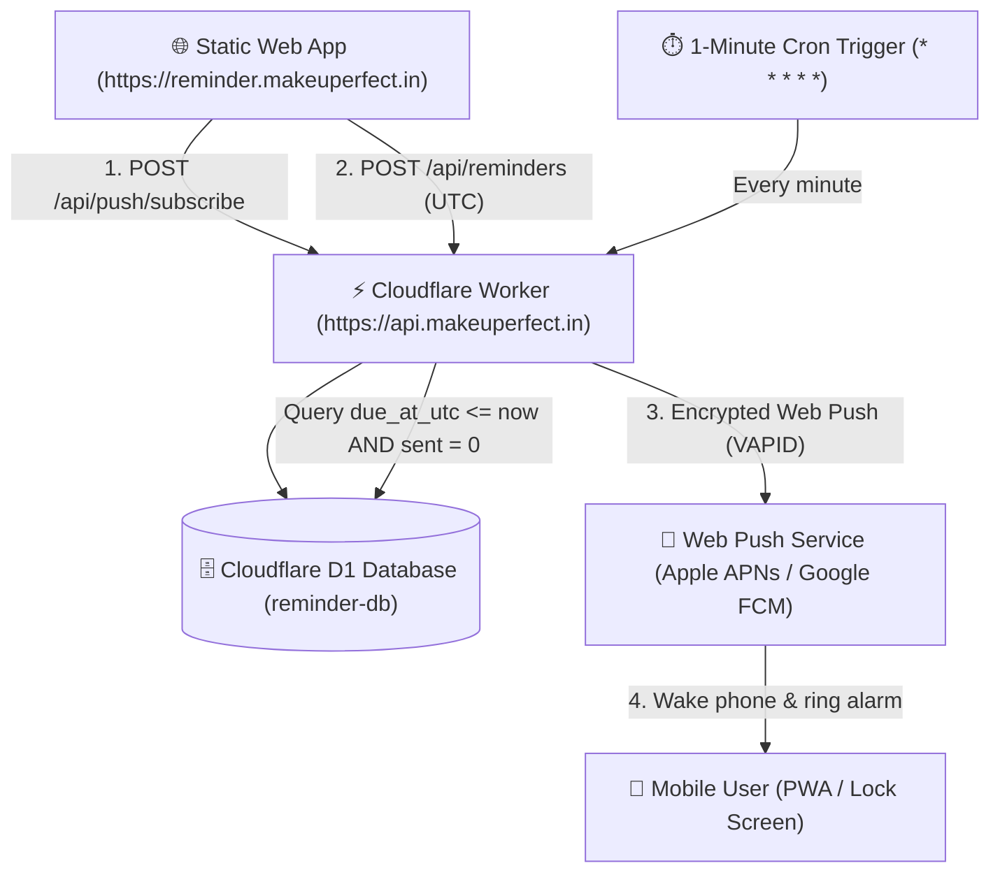

# reminderme - Cloudflare Worker & D1 Backend (`worker/`)

Lightweight, serverless Cloudflare Worker backend powered by **Cloudflare D1 SQL storage** and a **1-minute Cron Trigger** (`* * * * *`) to deliver real, locked-screen Web Push notifications to mobile devices for `https://reminder.makeuperfect.in`.

---

## Architecture Overview



---

## Features

1. **Cloudflare D1 Storage:**
   - `subscriptions`: Stores browser push endpoints, p256dh, and auth encryption keys.
   - `reminders`: Stores reminder title, body, and UTC epoch timestamp (`due_at_utc`) linked to subscription endpoint.
2. **1-Minute Cron Trigger (`[triggers] crons = ["* * * * *"]`):**
   - Cloudflare automatically invokes `scheduled()` every 60 seconds.
   - Queries all unsent reminders where `due_at_utc <= now`.
   - Sends high-urgency, lock-screen notifications using `web-push`.
   - Automatically marks them as `sent = 1` and cleans up expired (`410 Gone` / `404 Not Found`) subscriptions.
3. **CORS Configured:**
   - Pre-configured to allow requests from `https://reminder.makeuperfect.in` and `http://localhost:*`.
4. **Manual Cron Endpoint:**
   - `POST /api/cron/check-reminders` protected by `Authorization: Bearer ${CRON_SECRET}` for testing and external webhooks.

---

## Step-by-Step Deployment Guide

### Step 1: Install Dependencies
Open your terminal in the `worker` directory:

```bash
cd glassy-daily/worker
npm install
```

### Step 2: Create Cloudflare D1 Database
Create the D1 database in your Cloudflare account:

```bash
npx wrangler d1 create reminder-db
```

Output will look like:
```text
[[d1_databases]]
binding = "DB"
database_name = "reminder-db"
database_id = "xxxxxxxx-xxxx-xxxx-xxxx-xxxxxxxxxxxx"
```

Copy the generated `database_id` and paste it into `worker/wrangler.toml`:

```toml
[[d1_databases]]
binding = "DB"
database_name = "reminder-db"
database_id = "xxxxxxxx-xxxx-xxxx-xxxx-xxxxxxxxxxxx"
```

### Step 3: Apply the SQL Schema to D1

Apply the table structure to your remote production D1 database:

```bash
npx wrangler d1 execute reminder-db --remote --file=./schema.sql
```

*(Optional: For local development testing, run: `npx wrangler d1 execute reminder-db --local --file=./schema.sql`)*

### Step 4: Set Production Secrets

Set your VAPID keys and cron secret securely in Cloudflare:

```bash
# 1. Set VAPID Public Key
npx wrangler secret put VAPID_PUBLIC_KEY
# When prompted, paste: BEva2f0OpYSd0B9h6r2D0s1CtpRM0nSeU1DqvWOJ0di0LVsyUnuaHyxB6xZTSeUUKtA6bARhgs6zW6rvSJsPkE0

# 2. Set VAPID Private Key
npx wrangler secret put VAPID_PRIVATE_KEY
# When prompted, paste: bmUDYaZYOvHT-wu3VzTYrdH2RDlB5NENQ6v3Bd-lqDs

# 3. Set Cron Secret
npx wrangler secret put CRON_SECRET
# When prompted, paste: your_secure_cron_secret_token
```

### Step 5: Deploy the Worker

Deploy your worker to Cloudflare's global edge:

```bash
npx wrangler deploy
```

---

## Route & Custom Domain Configuration

In your Cloudflare Dashboard for domain `makeuperfect.in`:
1. Go to **Workers & Pages** → Select `reminder-worker`.
2. Go to **Settings** → **Triggers** → **Custom Domains**.
3. Add Custom Domain: `api.makeuperfect.in`.
4. Cloudflare will automatically provision SSL/TLS and route all traffic on `https://api.makeuperfect.in/*` to your Worker!

---

## Worker API Reference

| Method | Endpoint | Description |
|---|---|---|
| `GET` | `/api/health` | Healthcheck and current UTC server time. |
| `GET` | `/api/push/key` | Returns `{ publicKey: "..." }` for frontend Web Push subscription. |
| `POST` | `/api/push/subscribe` | Upserts a browser `PushSubscription` in D1. |
| `POST` | `/api/push/test` | Sends an instant test push to the subscriber device. |
| `POST` | `/api/reminders` | Upserts a scheduled reminder with UTC epoch timestamp (`due_at_utc`). |
| `DELETE` | `/api/reminders/:id` | Deletes or cancels a pending reminder. |
| `POST` | `/api/cron/check-reminders` | Protected test endpoint to run the cron reminder check manually. |
